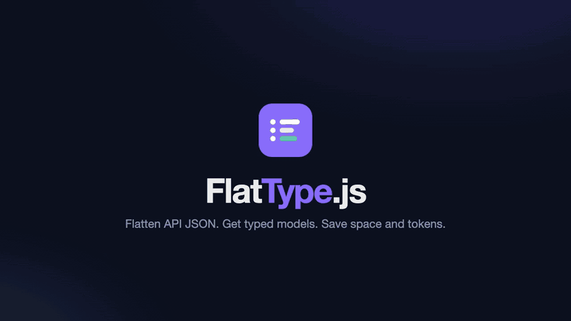

<p align="center">
  <a href="https://github.com/karammm/flattype">
    <picture>
      <source media="(prefers-color-scheme: dark)" srcset="docs/assets/logo-dark.svg">
      
    </picture>
  </a>
</p>

<p align="center">
  <strong>Flatten API JSON. Get typed models. Save space and tokens.</strong><br>
  A tiny TypeScript toolkit that turns backend responses into compact <code>key: value</code> text and maps them to typed models, for any frontend framework and for LLMs such as Claude.
</p>

<p align="center">
  <a href="https://www.npmjs.com/package/@flattype/core"></a>
  <a href="https://www.npmjs.com/package/@flattype/models"></a>
  <a href="https://www.npmjs.com/package/@flattype/http"></a>
  <a href="https://github.com/karammm/flattype/actions/workflows/ci.yml"></a>
  
  
  <a href="LICENSE"></a>
</p>

<p align="center">
  <a href="#quick-start"><b>Quick start</b></a> ·
  <a href="#the-format"><b>Format</b></a> ·
  <a href="#typed-models"><b>Models</b></a> ·
  <a href="#http"><b>HTTP</b></a> ·
  <a href="#benchmarks"><b>Benchmarks</b></a> ·
  <a href="CHANGELOG.md"><b>Changelog</b></a> ·
  <a href="ROADMAP.md"><b>Roadmap</b></a>
</p>

<p align="center">
  <a href="docs/assets/flattype-intro.mp4">
    
  </a>
  <br>
  <sub>▶ <a href="docs/assets/flattype-intro.mp4">Watch the 52-second intro in full quality</a>. Every result shown is real output, generated by <a href="scripts/video/record.mjs"><code>scripts/video/record.mjs</code></a>.</sub>
</p>

---

## Quick start

```bash
npm install @flattype/core @flattype/models @flattype/http
```

```ts
import { encode, decode } from "@flattype/core";

encode({ name: "John", age: 30, city: "New York" });
// name: John
// age: 30
// city: New York

decode("name: John\nage: 30"); // { name: "John", age: 30 }
```

Lists, the shape of most API responses, become tables. Keys are written once, and nested objects become dot paths:

```ts
encode({
  page: 1,
  users: [
    { id: 1, name: "Alice", address: { city: "Paris" } },
    { id: 2, name: "Bob", address: { city: "Delhi" } },
  ],
});
// page: 1
// users[2]{id,name,address.city}:
//   1, Alice, Paris
//   2, Bob, Delhi
```

Map the response to typed models in one line:

```ts
import { defineModel, type Infer } from "@flattype/models";

const User = defineModel({ id: "number", fullName: "string", createdAt: "date" });
type User = Infer<typeof User>; // { id: number; fullName: string; createdAt: Date }

const users = User.parseList(await res.json()); // full_name → fullName, ISO string → Date
```

Or let both ends speak Flat Notation, with JSON for every other client:

```ts
import { flatExpress, flatFetch } from "@flattype/http";

app.use(flatExpress()); // server: res.json() answers in Flat Notation when the client asks

const users = await flatFetch("/api/users", { model: User, list: true }); // client: User[]
```

## Why FlatType

- **About half the size on list payloads.** A list of 1,000 users is 45% smaller than minified JSON and 50% smaller than TOON, because keys are written once and nested fields are flattened into the table header.
- **Made for LLM context.** You pay for every character you send to Claude or another model. Flat Notation is plain `key: value` text that both models and people read easily, and `decode(text, { strict: false })` recovers data from model replies.
- **Typed models without boilerplate.** Declare the fields you want and get full TypeScript types. snake_case keys, numeric strings, ISO dates, defaults and nullable fields are handled for you, and every problem is reported with its path.
- **Drop-in for your API.** One middleware for Express, Fastify, Hono or any fetch-API server. Clients that ask get Flat Notation, everyone else still gets JSON, and big lists can be streamed row by row.
- **Lossless.** `decode(encode(x))` always equals `JSON.parse(JSON.stringify(x))`. Thousands of random values check this on every test run.
- **Small and safe.** The core is 3.7 KB min+gz, with no third-party dependencies. It's ESM + CJS with full types, works in the browser and Node 18+, and guards against `__proto__` pollution.

## Packages

| Package | What it does | Size (min+gz) |
| --- | --- | ---: |
| [`@flattype/core`](packages/core) | `encode`, `decode`, `createDecoder`, `flatten`, `unflatten`, `stats` | 3.7 KB |
| [`@flattype/models`](packages/models) | `defineModel`, `infer`, `toSource`: typed models from JSON or Flat Notation | +3.2 KB |
| [`@flattype/http`](packages/http) | `flatFetch`, `createClient`, `flatAxios`, `streamRows`, and `flatExpress` / `flatFastify` / `flatHono` | +2.3 KB |
| [`@flattype/shared`](packages/shared) | Shared TypeScript types | types only |

React, Vue, Angular and Svelte bindings, Claude helpers and a CLI are planned. See the [roadmap](ROADMAP.md).

## The format

Flat Notation is line-based. Each line is a path and a value:

```
name: John
zip: "10001"
user.address.city: Paris
"first name": John
tags[]: admin, editor
items[0].id: 1
items[1]: 2
empty: {}
none: []
users[2]{id,name}:
  1, Alice
  2, Bob
```

| Rule | Example |
| --- | --- |
| Nested objects become dot paths | `user.address.city: Paris` |
| Arrays of primitives go inline | `tags[]: admin, editor` |
| Arrays of same-shaped objects become a table: count, fields, then one row per line | `users[2]{id,name}:` |
| Other arrays use indexed paths | `items[0].id: 1` |
| `null`, `true`, `false` and numbers are written as in JSON | `age: 30` |
| Strings are bare unless they could be misread, then JSON-quoted | `zip: "10001"`, `note: ""` |
| Keys that aren't `[A-Za-z0-9_$-]+` are quoted | `"first name": John` |
| Lines starting with `#` are comments | `# generated 2026-10-16` |

Other delimiters are written into the brackets, as `tags[|]:` and `users[2|]{id|name}:`, so `decode` needs no options.

## Typed models

```ts
import { defineModel, infer, toSource, type Infer } from "@flattype/models";

const Address = defineModel({ city: "string", zip: "string" });

const User = defineModel({
  id: "number",                                  // "7" is coerced to 7
  name: "string",
  createdAt: "date",                             // reads created_at; ISO string or epoch ms → Date
  bio: "string?",                                // string | null, null when missing
  role: { type: "string", default: "viewer" },
  nickname: { type: "string", optional: true },  // left out when missing
  address: Address,                              // nested model
  tags: ["string"],                              // array
});
type User = Infer<typeof User>;

User.parse(json);          // a JSON value or a Flat Notation string
User.parseList(json.data); // arrays, including Flat Notation tables
User.safeParse(json);      // { ok: true, value } | { ok: false, error }
User.serialize(user);      // back to API JSON (dates as ISO strings)
User.encode(users);        // straight to Flat Notation
```

`parse` throws a `ModelError` listing **every** problem with its path, for example `address.zip: Required` and `tags[1]: Expected string, got object`. Unknown keys such as `password_hash` are dropped.

| Option | Default | Effect |
| --- | --- | --- |
| `keys` | `"auto"` | `"auto"` reads `createdAt` or `created_at`. `"snake"` also serializes back to snake_case. `"exact"` only reads the field name. |
| `coerce` | `true` | Converts `"42"` → `42` and `"true"`/`1` → `true`. Set `false` to require exact types. |

**Generate models from a real response:**

```ts
console.log(toSource(infer(await res.json()), "UsersPage"));
```

```ts
import { defineModel, type Infer } from "@flattype/models";

export const UsersPageData = defineModel({
  id: "number",
  fullName: "string",
  createdAt: "date",
  bio: "string?",
  vip: { type: "boolean", optional: true },
}, { keys: "snake" });
export type UsersPageData = Infer<typeof UsersPageData>;

export const UsersPage = defineModel({
  page: "number",
  data: [UsersPageData],
});
export type UsersPage = Infer<typeof UsersPage>;
```

## HTTP

`@flattype/http` adds Flat Notation to an existing API without breaking anyone. A response is re-encoded only when the request says `Accept: text/x-flat`, and `Vary: Accept` keeps caches correct.

**Server**

```ts
import { flatExpress, flatFastify, flatHono, negotiate } from "@flattype/http";

expressApp.use(flatExpress());                         // Express: res.json(...)
await fastifyApp.register(flatFastify);                // Fastify: object replies
honoApp.use(flatHono());                               // Hono: c.json(...)
return negotiate(request, Response.json(data));        // Bun, Deno, Next.js route handlers, Workers
```

**Client**

```ts
import { createClient, flatAxios, flatFetch, streamRows } from "@flattype/http";

const user = await flatFetch("/api/users/7", { model: User });          // typed, throws HttpError on 4xx/5xx

const api = createClient({ baseURL: "https://api.example.com/v1", headers: { authorization } });
const page = await api.get("/users", { query: { page: 2 } });
await api.post("/users", { name: "Chen" });                              // JSON request body

const axiosApi = flatAxios(axios.create({ baseURL: "/api" }));           // axios: response.data is decoded

for await (const { path, index, value } of streamRows("/api/export")) {  // rows while still downloading
  table.append(value);
}
```

A JSON-only server works with every client helper: the response is just read as JSON.

## Benchmarks

`pnpm compare` on the fixtures in [`fixtures/`](fixtures/index.mjs) (Node 24, Apple Silicon):

| Payload | JSON (minified) | [TOON](https://github.com/toon-format/toon) | **Flat Notation** | vs JSON |
| --- | ---: | ---: | ---: | ---: |
| List of 100 users | 16,691 B | 18,589 B | **9,151 B** | **−45%** |
| List of 1,000 users | 169,545 B | 188,544 B | **93,606 B** | **−45%** |
| Single profile object | 146 B | 133 B | 151 B | +3% |
| Mixed-shape events | 3,606 B | 3,785 B | 3,599 B | 0% |

| Decode 1,000 users | Time |
| --- | ---: |
| `JSON.parse` (native) | 0.34 ms |
| **FlatType `decode`** | **0.73 ms** |
| TOON `decode` | 5.9 ms |

Some honest notes on these numbers:

- **The savings come from lists.** A single small object is about the same size as JSON.
- **Gzip already removes most of JSON's repeated keys,** so gzipped network sizes come out close. FlatType makes the biggest difference where text isn't compressed: LLM prompts and tool results, logs, caches and local storage.
- **`JSON.parse` is native code, so it's still faster.** FlatType decodes at about half its speed and about 8× faster than the TOON reference decoder.

## Development

```bash
pnpm install
pnpm build && pnpm typecheck && pnpm test
pnpm bench        # encode/decode vs JSON
pnpm compare      # size and parse time vs JSON and TOON
pnpm check:size   # bundle budgets
pnpm video        # re-render docs/assets/flattype-intro.{mp4,gif} (needs ffmpeg)
```

This is a pnpm + Turborepo monorepo built with tsup and tested with Vitest and fast-check. Releases use Changesets, and all `@flattype/*` packages share one version number. Every release follows the checklist in [ROADMAP.md](ROADMAP.md).

## Contributing

Issues and pull requests are welcome. If you have a payload that FlatType handles badly, please [open an issue](https://github.com/karammm/flattype/issues) with a sample; it becomes a test fixture.

## License

[MIT](LICENSE)
